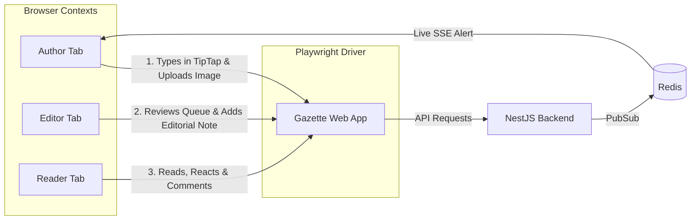
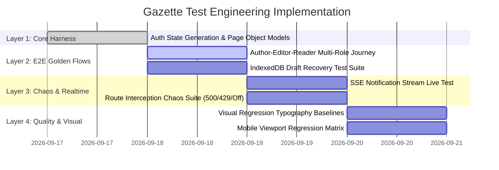

# Gazette CMS — Production Testing Architecture & Playwright Harness

> **Document Type:** Production Architecture & Test Engineering Blueprint  
> **System:** Gazette Editorial CMS Platform  
> **Version:** 2.0 (Production Refined)  
> **Scope:** Full-Stack Testing Pyramid (Unit ➔ DB Contracts ➔ Workers ➔ API Contracts ➔ Playwright E2E ➔ k6 Load)

---

## 📑 Table of Contents
1. [The Gazette Testing Pyramid](#1-the-gazette-testing-pyramid)
2. [Playwright's Precise Role in the Stack](#2-playwrights-precise-role-in-the-stack)
3. [The Gazette Golden Journey (Multi-Role E2E)](#3-the-gazette-golden-journey-multi-role-e2e)
4. [Dual-Mode Playwright Strategy](#4-dual-mode-playwright-strategy)
   - [Mode A: Real E2E (Golden Path)](#mode-a-real-e2e-golden-path)
   - [Mode B: Controlled Network Interception (Chaos & Edge Cases)](#mode-b-controlled-network-interception-chaos--edge-cases)
5. [Multi-Database Testing Architecture](#5-multi-database-testing-architecture)
   - [Repository Contract Testing Layer (Fast & Exhaustive)](#repository-contract-testing-layer-fast--exhaustive)
   - [Playwright DB Mesh Switch Smoke Test](#playwright-db-mesh-switch-smoke-test)
6. [P0 Draft Recovery & Offline Sync (IndexedDB)](#6-p0-draft-recovery--offline-sync-indexeddb)
7. [Real-time SSE Notification Stream Verification](#7-real-time-sse-notification-stream-verification)
8. [Visual Regression & Typography Freeze Rules](#8-visual-regression--typography-freeze-rules)
9. [CI Tiering & Browser Matrix Strategy](#9-ci-tiering--browser-matrix-strategy)
10. [Test Data Hygiene, Determinism & Failure Diagnostics](#10-test-data-hygiene-determinism--failure-diagnostics)
11. [Target Directory Structure](#11-target-directory-structure)
12. [Implementation Roadmap](#12-implementation-roadmap)

---

## 1. The Gazette Testing Pyramid

Gazette does **not** make Playwright responsible for testing every combinatorial variation of 17 modules × 6 databases × 5 browsers. Instead, we establish an industrial-grade testing pyramid:

```
                         ┌─────────────────────────┐
                         │      Playwright E2E     │  ◄── Critical User Journeys
                         │    (12 Golden Flows)    │      (Real Browsers, Auth & UI)
                         └────────────┬────────────┘
                                      │
                     ┌────────────────┴────────────────┐
                     │                                 │
           API Contract Tests                 Component Unit Tests
         (65 Endpoint Contracts)             (React Testing Library)
                     │                                 │
        ┌────────────┴────────────┐                    │
        │                         │                    │
 DB Adapter Contracts      BullMQ Worker Tests         │
   (6 Storage Engines)      (PDF/Video/Publish)        │
        │                         │                    │
        └────────────┬────────────┴────────────────────┘
                     │
              Unit & Domain Logic
            (33 Suites, 228 Tests)
```

### Layer Responsibilities:
* **Playwright E2E:** *"Can a human user accomplish their core workflow end-to-end?"*
* **API Contracts:** *"Do the NestJS HTTP/REST responses strictly match frontend expectations & Zod schemas?"*
* **DB Adapter Contracts:** *"Do PostgreSQL, MongoDB, MariaDB, MySQL, CockroachDB, and ClickHouse implement the identical repository interface identically?"*
* **BullMQ Worker Tests:** *"Do scheduled publishing, PDF ingestion, video transcoding, and newsletter dispatch succeed without the browser?"*
* **k6 (Separate):** *"Can the API and Redis layer sustain 5,000 req/sec under concurrency?"*

---

## 2. Playwright's Precise Role in the Stack

Playwright is reserved strictly for high-value user workflows that require browser execution (DOM rendering, focus management, rich text manipulation, dual-theme styling, multi-user concurrency):



---

## 3. The Gazette Golden Journey (Multi-Role E2E)

The primary E2E test validates the full multi-role editorial lifecycle across 3 distinct browser contexts in a single coordinated run:

```
AUTHOR
  │
  ├─ 1. Login with Argon2id credentials
  ├─ 2. Open TipTap Studio (/editor)
  ├─ 3. Input headline, deck, rich formatting, and native image upload
  ├─ 4. Save draft (verifies IndexedDB backup)
  ├─ 5. Navigate away & verify draft auto-recovery prompt
  └─ 6. Submit story for review (DRAFT ➔ IN_REVIEW)
       │
       ▼
EDITOR
  │
  ├─ 7. Open Admin Review Queue (/admin/review-queue)
  ├─ 8. Inspect story diff, word count, reading time
  ├─ 9. Attach editorial note & assign to Publishing Slot
  └─ 10. Approve & Schedule (IN_REVIEW ➔ SCHEDULED / PUBLISHED)
       │
       ▼
READER
  │
  ├─ 11. Open public article page (/article/:slug)
  ├─ 12. Read article (view count incremented)
  ├─ 13. Click Like & Bookmark
  ├─ 14. Post threaded Comment (sanitized by DOMPurify)
       │
       ▼
AUTHOR (SSE Live Loop)
  └─ 15. Notification badge live updates to '1' without page reload
```

---

## 4. Dual-Mode Playwright Strategy

To keep testing fast and deterministic, Playwright operates in **two distinct modes**:

### Mode A: Real E2E (Golden Path)
* **Target:** Real Vite frontend ➔ Real NestJS backend ➔ Real Redis ➔ Active Database.
* **Usage:** PR release gates, deployment smoke checks, golden journeys.
* **Focus:** Complete happy-path validation and multi-user concurrency.

### Mode B: Controlled Network Interception (Chaos & Edge Cases)
* **Target:** Vite frontend with Playwright `page.route()` interception.
* **Usage:** Testing edge conditions and failure states without crashing real backend services:
  * `500 Internal Server Error` ➔ Verifies graceful toast notifications and non-blocking UI.
  * `429 Too Many Requests` (Rate Limiting) ➔ Verifies countdown timer feedback.
  * `Network Timeout / Offline Mode` ➔ Verifies offline indicator and IndexedDB local save.
  * `403 Forbidden` ➔ Verifies role redirection without token leakage.

---

## 5. Multi-Database Testing Architecture

### Repository Contract Testing Layer (Fast & Exhaustive)
Rather than executing thousands of heavy browser tests per database, we run a unified **Repository Contract Test Suite** directly in Jest:

```typescript
// server/src/repositories/contracts/article-repository.contract.ts
export function describeArticleRepositoryContract(
  name: string,
  getRepository: () => Promise<IArticleRepository>,
) {
  describe(`Article Repository Contract: ${name}`, () => {
    let repo: IArticleRepository;

    beforeAll(async () => {
      repo = await getRepository();
    });

    it('should create and retrieve article by ID and slug', async () => { /* ... */ });
    it('should handle pagination and status filtering correctly', async () => { /* ... */ });
    it('should handle optimistic locking and version updates', async () => { /* ... */ });
    it('should perform soft deletes without data loss', async () => { /* ... */ });
  });
}

// Executed against all 6 active database engines:
describeArticleRepositoryContract('PostgreSQL', () => getPostgresRepo());
describeArticleRepositoryContract('MongoDB', () => getMongoRepo());
describeArticleRepositoryContract('MariaDB', () => getMariaRepo());
describeArticleRepositoryContract('MySQL', () => getMySqlRepo());
describeArticleRepositoryContract('CockroachDB', () => getCockroachRepo());
```

### Playwright DB Mesh Switch Smoke Test
Playwright tests **only the UI contract** of switching engines:
1. SuperAdmin opens `/admin/database`.
2. Selects a new target database engine.
3. Clicks "Switch Engine".
4. Verifies active badge updates, article lists reload cleanly, and active JWT session remains valid.

---

## 6. P0 Draft Recovery & Offline Sync (IndexedDB)

Draft safety is a mission-critical editorial feature. Playwright validates Gazette's **IndexedDB storage layer**:

```typescript
test('Editor recovers unsaved draft from IndexedDB after unexpected tab crash', async ({ page }) => {
  await page.goto('/editor');
  
  // 1. Author types in story
  await page.locator('.tiptap.ProseMirror').fill('Exclusive Breaking News: System Online...');
  
  // 2. Wait for IndexedDB debounced auto-persist (500ms)
  await page.waitForTimeout(600);

  // 3. Simulate sudden crash / refresh without explicit manual save
  await page.reload();

  // 4. Verify draft recovery modal appears with local snapshot
  const recoveryModal = page.getByRole('dialog', { name: /Recover Unsaved Draft/i });
  await expect(recoveryModal).toBeVisible();

  // 5. Restore snapshot and verify content restored into TipTap editor
  await page.getByRole('button', { name: /Restore Draft/i }).click();
  await expect(page.locator('.tiptap.ProseMirror')).toContainText('Exclusive Breaking News');
});
```

---

## 7. Real-time SSE Notification Stream Verification

Instead of inspecting browser `EventSource` internals, Playwright verifies the **observable UI contract**:

```typescript
test('Author receives real-time notification badge when story is liked by reader', async ({ browser }) => {
  const authorCtx = await browser.newContext({ storageState: 'playwright/.auth/author.json' });
  const readerCtx = await browser.newContext({ storageState: 'playwright/.auth/reader.json' });

  const authorPage = await authorCtx.newPage();
  const readerPage = await readerCtx.newPage();

  // Author navigates to dashboard
  await authorPage.goto('/dashboard');
  const badge = authorPage.getByTestId('unread-notifications-badge');
  await expect(badge).toHaveText('0');

  // Reader likes author's article
  await readerPage.goto('/article/the-future-of-publishing');
  await readerPage.getByTestId('like-btn').click();

  // Author UI updates in real-time via SSE push
  await expect(badge).toHaveText('1', { timeout: 5000 });

  await authorCtx.close();
  await readerCtx.close();
});
```

---

## 8. Visual Regression & Typography Freeze Rules

Visual regression tests safeguard Gazette's typography and dual themes without generating flaky false alarms:

### Strict Freeze Rules:
* **Freeze Dynamic Timestamps:** Replace dynamic `createdAt` dates with static `"September 17, 2026"`.
* **Mask Avatars & Random IDs:** Mask dynamic avatars and random UUIDs.
* **Disable CSS Transitions/Animations:** Set `prefers-reduced-motion: reduce` in browser context.
* **Tiered Tolerances:**
  * **Typography & Reader Layouts:** `maxDiffPixelRatio: 0.005` (Strict).
  * **Admin Data Grids & Metrics:** `maxDiffPixelRatio: 0.02` (Standard).

```typescript
test('Article Reader renders identical pixel baseline in Dark & Light modes', async ({ page }) => {
  await page.goto('/article/future-of-editorial-publishing');
  await page.emulateMedia({ colorScheme: 'dark' });
  
  await expect(page.locator('article.prose-editorial')).toHaveScreenshot('reader-dark.png', {
    maxDiffPixelRatio: 0.005,
  });

  await page.getByRole('button', { name: /Toggle theme/i }).click();
  await expect(page.locator('article.prose-editorial')).toHaveScreenshot('reader-light.png', {
    maxDiffPixelRatio: 0.005,
  });
});
```

---

## 9. CI Tiering & Browser Matrix Strategy

To ensure sub-3-minute PR build times while maintaining bulletproof cross-browser compatibility:

| Tier | When It Runs | Browsers / Viewports | Test Scope | Target Duration |
|:---|:---|:---|:---|:---:|
| **Tier 1 (PR Smoke)** | Every Pull Request | Chromium (Desktop) | Golden Journey + Auth + Draft Recovery | `< 90s` |
| **Tier 2 (Regression)** | Merge to `main` | Chromium, Firefox, WebKit | All 12 Golden Journeys + Chaos / Offline | `< 4m` |
| **Tier 3 (Mobile Matrix)** | Nightly / Release | iPhone 15 Pro, Pixel 8 | Mobile Navigation, Touch gestures, Reader | `< 3m` |
| **Tier 4 (Visual Golden)** | Design System Changes | Chromium (Dark/Light) | 15 Core Viewports | `< 2m` |

---

## 10. Test Data Hygiene, Determinism & Failure Diagnostics

### 1. Deterministic Test Run ID
Every test execution generates an isolated namespace:
```typescript
const TEST_RUN_ID = `run_${Date.now()}_${Math.random().toString(36).substring(7)}`;
const testArticleSlug = `test-article-${TEST_RUN_ID}`;
```

### 2. Automated Auth Storage Caching
Pre-seeded authentication states stored in `playwright/.auth/` (ignored by Git) so tests never re-run slow login forms before every spec:
```
playwright/.auth/
├── superadmin.json
├── editor.json
├── author.json
└── reader.json
```

### 3. Comprehensive Artifact Preservation
On any test failure, Playwright automatically records and preserves:
* **Trace File (`trace.zip`)** — Inspect full DOM snapshot, network watermarks, and console logs in Playwright Trace Viewer.
* **Failure Screenshot (`error.png`)**.
* **Video Recording of failed run**.

---

## 11. Target Directory Structure

```
client/tests/
│
├── e2e/
│   ├── auth/
│   │   ├── login-lifecycle.spec.ts         # Login, session, token rotation
│   │   └── role-boundaries.spec.ts         # Unauthorized route redirection
│   │
│   ├── editorial/
│   │   ├── golden-journey.spec.ts          # Complete Author ➔ Editor ➔ Reader flow
│   │   ├── draft-recovery.spec.ts          # IndexedDB offline persistence & restore
│   │   └── revision-history.spec.ts        # Revert to historical version
│   │
│   ├── reader/
│   │   ├── article-reader.spec.ts          # Typography, reading progress, shares
│   │   └── engagement.spec.ts              # Likes, Bookmarks, Threaded Comments
│   │
│   ├── realtime/
│   │   └── sse-notifications.spec.ts       # Live notification push & badge count
│   │
│   ├── admin/
│   │   └── database-mesh-switch.spec.ts    # UI engine switcher smoke test
│   │
│   └── visual/
│       ├── reader-typography.spec.ts       # Editorial golden snapshots
│       └── theme-dark-light.spec.ts        # Dual-theme palette verification
│
├── fixtures/
│   ├── auth.fixture.ts                     # Pre-authenticated context injection
│   └── test-data.factory.ts                # Deterministic article & user generators
│
├── pages/                                  # Page Object Models (POM)
│   ├── LoginPage.ts
│   ├── EditorPage.ts
│   ├── ReviewQueuePage.ts
│   ├── ReaderPage.ts
│   └── AdminDatabasePage.ts
│
├── helpers/
│   ├── cleanup.helper.ts                   # Post-run test entity purging
│   └── sse-listener.helper.ts              # SSE verification utility
│
└── playwright.config.ts                    # Tiered multi-project configuration
```

---

## 12. Implementation Roadmap



---

### 🎯 Key Architectural Rules
1. **Never make Playwright test DB engine edge cases** ➔ Use Jest Repository Contract tests.
2. **Never test BullMQ background jobs through slow UI polling** ➔ Use direct worker integration specs.
3. **Never hardcode static dates in visual snapshots** ➔ Freeze clocks and dynamic text.
4. **Always clean up deterministic test entities** ➔ Zero data pollution in local or staging DBs.
