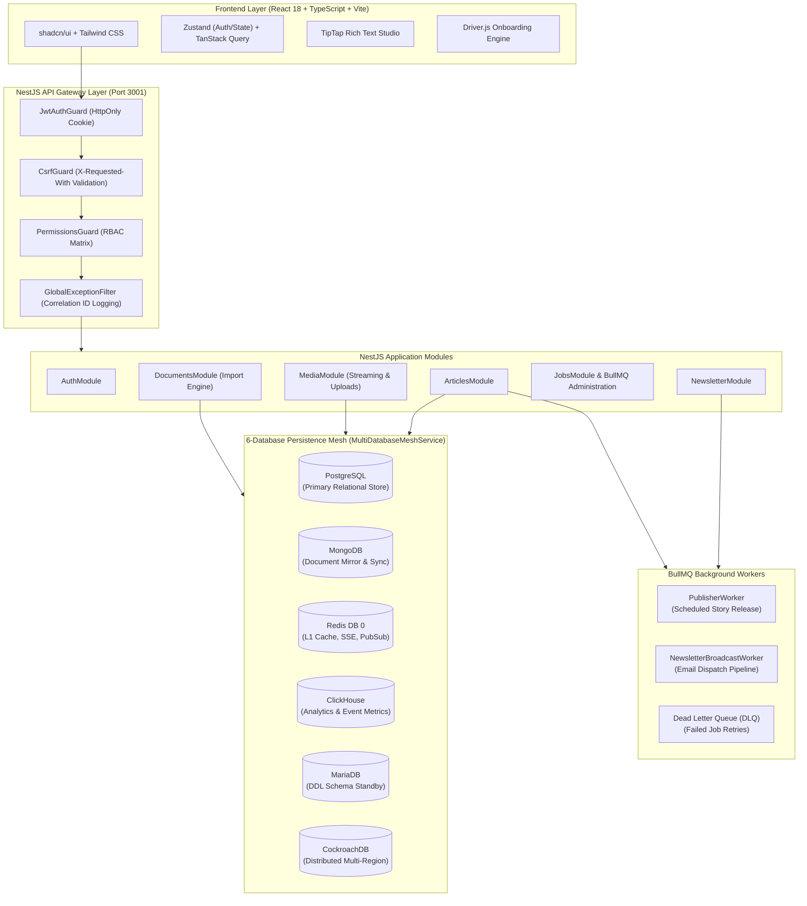
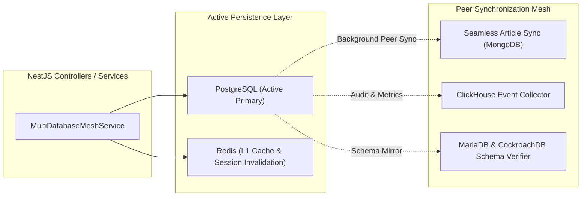
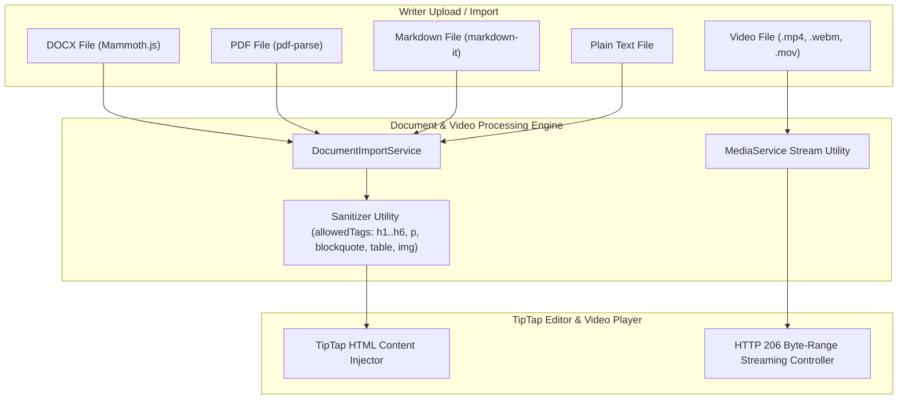
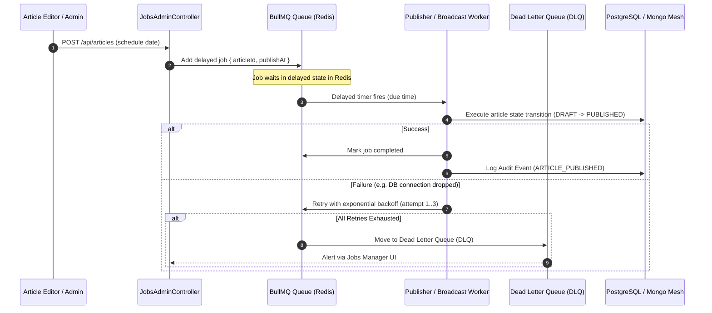
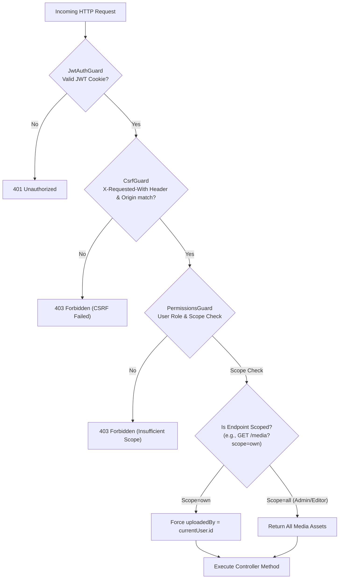

# The Gazette — System Architecture Diagrams (`ARCHITECTURE_DIAGRAMS.md`)

This document presents the complete system architecture for **The Gazette CMS**, structured using **Archify** system modeling patterns.

---

## 1. High-Level System Architecture Diagram

---

## 2. 6-Database Persistence Mesh Architecture

### Database Roles & Guarantees
1. **PostgreSQL (Active Primary):** Relational integrity, foreign keys, user credentials, articles, slot assignments.
2. **MongoDB (Document Mirror):** Peer article & revision document sync via `SeamlessArticleRepository`.
3. **Redis (DB 0):** Token blacklists, session storage, category cache with hard staleness eviction, SSE stream pub-sub.
4. **ClickHouse:** High-throughput analytical queries, reading stats, and event tracking.
5. **MariaDB & CockroachDB:** Standby DDL verification and distributed multi-region redundancy.

---

## 3. Multi-Format Document Import & Native Video Pipeline Architecture

---

## 4. BullMQ Background Worker & Queue Architecture

---

## 5. Security & RBAC Enforcement Flow

---

## 6. Document File Structure & Diagram Mapping

| Archify Diagram | Primary Code File(s) | Description |
|---|---|---|
| **System Architecture** | [`server/src/app.module.ts`](file:///c:/Users/shrut/Desktop/CMS%20Project/server/src/app.module.ts) | Complete NestJS application graph & dependencies |
| **6-DB Mesh** | [`multi-database-mesh.service.ts`](file:///c:/Users/shrut/Desktop/CMS%20Project/server/src/modules/database/multi-database-mesh.service.ts) | Multi-DB orchestrator & active engine switcher |
| **Document Import** | [`document-import.service.ts`](file:///c:/Users/shrut/Desktop/CMS%20Project/server/src/modules/documents/document-import.service.ts) | Mammoth, pdf-parse, markdown-it parser |
| **Video Streaming** | [`media.service.ts`](file:///c:/Users/shrut/Desktop/CMS%20Project/server/src/modules/media/media.service.ts) | HTTP 206 Partial Content byte-range video streamer |
| **BullMQ Queue** | [`jobs-admin.service.ts`](file:///c:/Users/shrut/Desktop/CMS%20Project/server/src/modules/jobs/jobs-admin.service.ts) | Queue monitoring, DLQ management, retries |
| **Security & RBAC** | [`media.controller.ts`](file:///c:/Users/shrut/Desktop/CMS%20Project/server/src/modules/media/media.controller.ts) | `scope=own` media isolation & CSRF/JWT guards |
