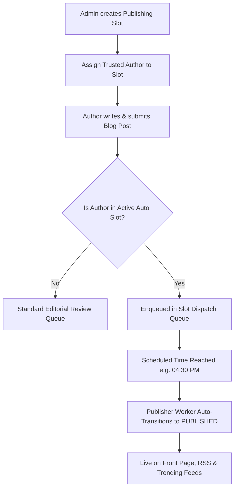

# 🕒 RFC: Author Publishing Slots & Automated Dispatch Engine
**Document Version:** 1.0.0  
**Status:** Discussion & Architecture Proposal  
**Target Module:** Editorial Workflow & Admin Governance Engine

---

## 💡 1. Executive Summary & Problem Understanding

### 🔴 The Problem
When the platform grows to hundreds of active writers submitting articles daily:
- Requiring administrators/editors to manually review and approve every single blog post creates an **extreme administrative bottleneck** and causes editor fatigue.
- Delays in review frustrate trusted authors who expect predictable publishing timelines.

### 🟢 The Proposed Solution: Author Publishing Slots
Instead of forcing every submission into a manual review queue:
1. **Automated Publishing Slots (Time Windows):** The admin defines scheduled publishing slots (e.g., *Daily Tech Digest @ 09:30 AM*, *Market Wrap @ 04:30 PM*, or custom user-specific release times).
2. **Author Slot Association:** The admin places vetted or verified authors into specific slots (e.g., Author A is assigned to the "4:30 PM Automated Slot").
3. **Automated Zero-Friction Dispatch:** When the designated author submits a blog post:
   - It is automatically queued into their assigned slot.
   - When the clock hits the exact slot time (e.g., **4:30 PM**), the background publishing engine automatically executes the state transition (`scheduled` / `slot_queued` → `published`) and pushes it live to the front page and feeds.
4. **Editorial Super-Control:** The admin retains a master timeline view to inspect upcoming slot queues, swap slots, modify release times, or pause/yank articles before they go live.

---

## 🏗️ 2. Architectural Blueprint



---

## 🗄️ 3. Proposed Data Architecture

### A. Publishing Slots Table (`cms_publishing_slots`)
```sql
CREATE TABLE IF NOT EXISTS cms_publishing_slots (
    id UUID PRIMARY KEY DEFAULT gen_random_uuid(),
    name VARCHAR(100) NOT NULL,              -- e.g. 'Evening Markets Wrap'
    slug VARCHAR(100) UNIQUE NOT NULL,       -- e.g. 'evening-markets-wrap'
    dispatch_time TIME NOT NULL,             -- e.g. '16:30:00' (4:30 PM)
    timezone VARCHAR(50) DEFAULT 'UTC',      -- e.g. 'Asia/Kolkata' or 'UTC'
    days_active VARCHAR(50) DEFAULT 'ALL',   -- e.g. 'MON,TUE,WED,THU,FRI' or 'ALL'
    max_articles_per_slot INT DEFAULT 5,     -- Maximum queue capacity per slot
    is_active BOOLEAN DEFAULT TRUE,
    created_at TIMESTAMP WITH TIME ZONE DEFAULT CURRENT_TIMESTAMP,
    updated_at TIMESTAMP WITH TIME ZONE DEFAULT CURRENT_TIMESTAMP
);
```

### B. Author Slot Mappings Table (`cms_author_slot_assignments`)
```sql
CREATE TABLE IF NOT EXISTS cms_author_slot_assignments (
    id UUID PRIMARY KEY DEFAULT gen_random_uuid(),
    author_id UUID NOT NULL REFERENCES cms_users(id) ON DELETE CASCADE,
    slot_id UUID NOT NULL REFERENCES cms_publishing_slots(id) ON DELETE CASCADE,
    auto_publish_enabled BOOLEAN DEFAULT TRUE,
    daily_quota INT DEFAULT 2,               -- Max auto-publishes per day
    assigned_by UUID REFERENCES cms_users(id),
    created_at TIMESTAMP WITH TIME ZONE DEFAULT CURRENT_TIMESTAMP,
    UNIQUE(author_id, slot_id)
);
```

### C. Article Queue Extension (`articles` table metadata)
```sql
ALTER TABLE articles ADD COLUMN IF NOT EXISTS publishing_slot_id UUID REFERENCES cms_publishing_slots(id);
ALTER TABLE articles ADD COLUMN IF NOT EXISTS scheduled_publish_at TIMESTAMP WITH TIME ZONE;
ALTER TABLE articles ADD COLUMN IF NOT EXISTS auto_dispatched BOOLEAN DEFAULT FALSE;
```

---

## ⚡ 4. End-to-End Workflow

```
[Author Studio] 
      │ (Submits Post)
      ▼
[Backend Validator] 
      │ Checks if Author has active Slot Assignment (e.g. 04:30 PM)
      │ Calculates next execution timestamp: Today @ 16:30 (or tomorrow if already past 16:30)
      ▼
[Status: SCHEDULED] 
      │ Stored in Database with scheduled_publish_at timestamp
      ▼
[Admin Slot Radar (Frontend)] 
      │ Displays upcoming pipeline: "3 articles queued for 04:30 PM Slot"
      │ Admin can click "Hold", "Re-schedule", or "Publish Now"
      ▼
[Scheduled Publisher Worker (Cron)] 
      │ Polls every 60s: SELECT * FROM articles WHERE status = 'scheduled' AND scheduled_publish_at <= NOW()
      │ Atomically updates status = 'published', auto_dispatched = true
      ▼
[Public Feed] 
      │ Article immediately visible on Reader Homepage & Trending Ticker
```

---

## 🎛️ 5. Admin Interface & Controls

1. **Slot Matrix Dashboard (`/admin/slots`):**
   - Visual timeline cards showing active slots (e.g., `09:00 AM`, `01:00 PM`, `04:30 PM`, `08:00 PM`).
   - Counter pills showing how many articles are in queue for each slot.
2. **Author Trust & Assignment Drawer:**
   - Search author by name or email.
   - Assign preferred slot and daily quota.
   - Quick-toggle to revoke auto-publish privileges at any time.
3. **Emergency Circuit Breaker:**
   - Single-click **"Freeze Slot"** button to temporarily hold all scheduled releases in case of site maintenance or urgent editorial review.

---

## 🔒 6. Security & Abuse Prevention

- **Daily Quota Enforcement:** Prevents an assigned author from flooding the slot with 50 posts.
- **Account Status Guard:** If an author is suspended or demoted, all their pending slot queues are automatically frozen.
- **Audit Logging:** Every automated transition logs an `ARTICLE_AUTO_DISPATCHED` entry to `cms_audit_logs`.

---

## 💬 7. Discussion Mode Alignment Questions

To make sure this matches your vision 100%, let's confirm these 3 details:

1. **Slot Granularity:** Should slots be **Fixed Recurring Times** (e.g., Every day at 4:30 PM) or can the admin set **Custom One-Off Times** per author/article (e.g., Specific date & time)?
2. **Queue Overflow:** If 3 authors in the 4:30 PM slot upload on the same day, should all 3 go live at 4:30 PM simultaneously, or should they be spaced out (e.g., 4:30 PM, 4:35 PM, 4:40 PM)?
3. **Author Transparency:** Should authors see which slot they are assigned to in their author dashboard (e.g., *"Your next story will go live in the 4:30 PM slot"*), or should it remain a purely admin-side setting?
